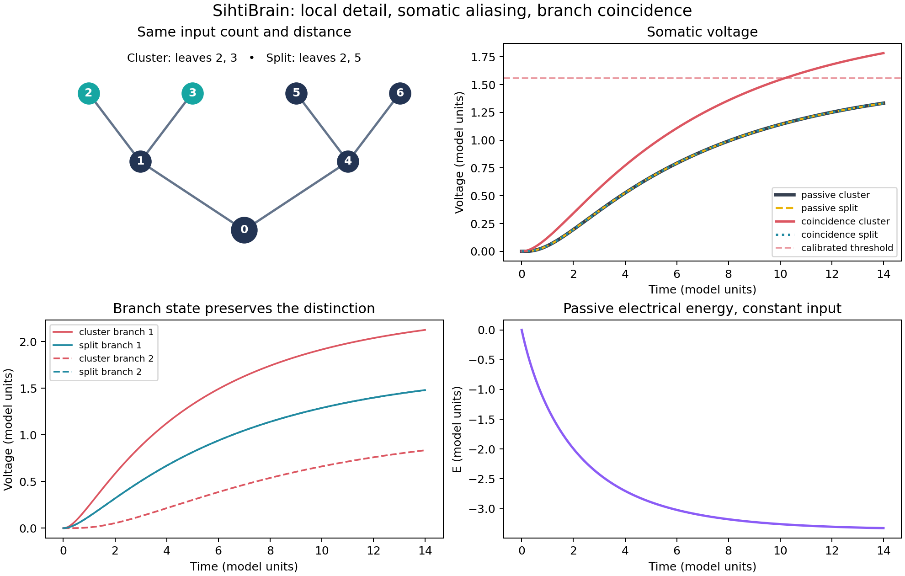
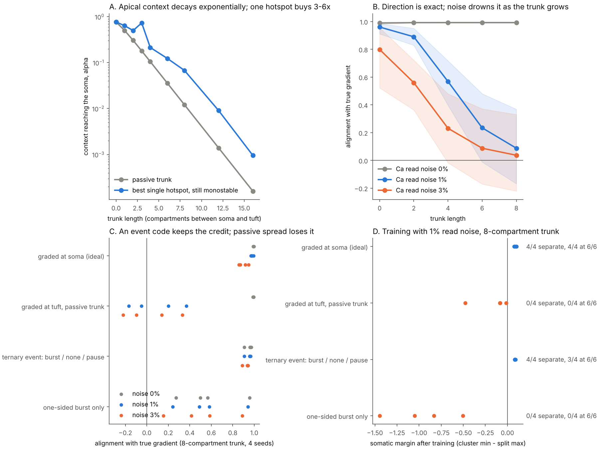
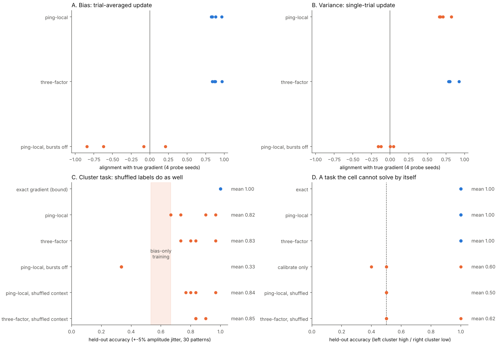

# SihtiBrain

**A small experiment about what a dendrite keeps, what a soma sees, and what a spike can report.**

The motivating thought was: a dendrite seems to *purify* a signal; perhaps the lost-looking detail is present as local gradients; the soma sums them; the spike keeps the process moving. The attached Gemini discussion extended this into automatic object basins and spikes that kick a system out of an energy valley. This repository tests the first part and marks the remaining parts as hypotheses.



## What the first experiment actually shows

There are two equally long branches, each with two input leaves. In **cluster**, two equal currents enter the leaves of the left branch. In **split**, one enters each branch. Both arrangements have two inputs at the same depth.

| Readout after 700 steps | Cluster | Split | Meaning |
| --- | ---: | ---: | --- |
| Passive somatic voltage | 1.33266 | 1.33266 | Indistinguishable at the soma by symmetry. |
| Left branch root voltage | 2.12436 | 1.47939 | The branch still contains spatial information. |
| Optional coincidence soma voltage | 1.78321 | 1.33266 | A local nonlinearity makes input arrangement visible. |
| Threshold crossings (threshold 1.55794) | 1 | 0 | The event reports that added selectivity. |

The maximum passive soma trace difference is `4.44e-16`; the final left-root difference is `0.645` and the left-root-to-soma current difference is `0.516` (dimensionless). With fixed external current, passive electrical energy decreases at each step. The event threshold was selected halfway between the two final nonlinear voltages, so this is a demonstration of separability, **not** a held-out classification result. The nonlinear branch term is deliberately phenomenological: it is **not** a simulated NMDA conductance.

An additional control applies the *same brief somatic current ping* to each passive case. It visibly perturbs the soma, yet the somatic traces remain identical. Linear passive propagation plus a broadcast pulse cannot reveal the hidden arrangement. This current pulse is externally imposed; it is not an action potential or a backpropagating spike.

Run on a CPU:

```bash
python -m pip install -r requirements.txt
python -m unittest discover -s tests -v
python demo.py --output runs/first_gate
```

`runs/first_gate/metrics.json` records the exact numbers and `sihtibrain.png` shows the traces. The checked-in figure was produced by the same command; rerun to compare it to the JSON.

## Second gate: the ping as a nudge

[`docs/PING_AS_NUDGE.md`](docs/PING_AS_NUDGE.md) (`ping_nudge.py`, `demo_ping_nudge.py`, `tests/test_ping_nudge.py`) gives the branch roots a *voltage-dependent* current and asks what the ping must be for "purify → summate → ping" to close:

* **Why the soma was blind:** 4 of the tree's 7 cable modes have exactly zero amplitude at the soma, and the cluster-minus-split input lies entirely in them. A fixed ping in any linear tree is blind by superposition.
* **Ping as error current = exact gradient:** injecting `−β(v₀ − y)` at the soma and relaxing again gives the gradient of the somatic loss by equilibrium propagation (error vs finite differences ∝ β², slope 2.02). The synaptic rule is local: presynaptic activity × how far the ping moved the voltage at that synapse; reciprocity `Z_i0 = Z_0i` makes it exact. On a cluster-detection task that **no passive tree can solve for any parameters** (proven floor, 4/6), error-pings train the nonlinear tree to **6/6 on 4/4 seeds**.
* **Ping as kick:** with bistable branches and *identical somatic voltage*, the same ping flips only the clustered branch into a persistent plateau (any amplitude in [4.07, 6.28)). It reads hidden branch state and writes it.


## Third gate: the ping with state, up and down

[`docs/PING_WITH_STATE.md`](docs/PING_WITH_STATE.md) (`ping_state.py`, `demo_ping_state.py`, `tests/test_ping_state.py`) removes the error current. A weak teacher shifts the soma, and two returning pings (one before the teacher, one during) evoke calcium at each active synapse through an NMDA-like unblock. Each synapse writes the fractional change in its own calcium. No signal anywhere encodes the error.

* **Exact in the linear tree:** below the unblock threshold, `log(Ca_teach / Ca_free) / k = Δv_i`, the equilibrium-propagation update (max deviation 6.5e-5), at any ping amplitude. The credit travels in the slow, reciprocal cable; the ping only samples it, so uneven bAP attenuation cancels.
* **Trains the nonlinear tree:** 4/4 seeds, 6/6 patterns, margin +0.142; absolute-calcium comparison 0/4; shuffled teacher 1/4; no ping 0/4.
* **Sign law:** a synapse whose local voltage plus ping sits past the unblock midpoint gets inverted credit (alignment ≈ −0.99) and the tree learns the opposite task.
* **Spike shape that varies with state** at the measured depth (~8%) neither helps nor hurts, even with Brunner's proximal/distal sign flip. Calcium read noise is the real weak point.
* **After the divergence:** the teacher is the "later window" at the apical tuft (prior art: Guerguiev, Lillicrap & Richards 2017). A loop with no outside information can hold state but cannot learn a task. The next gate puts the context at the tuft, where the shaped ping may become the only channel to basal synapses.


## Fourth gate: context at the tuft

[`docs/TUFT_CONTEXT.md`](docs/TUFT_CONTEXT.md) (`tuft_gate.py`, `demo_tuft.py`, `tests/test_tuft_gate.py`) adds a trunk and an apical tuft to the same basal tree and moves the context there.

* **The soma is the only door.** Because the soma separates the apical and basal trees, apical context reaches every basal synapse exactly as if injected at the soma, scaled by one number α (identity residual ≤ 2.4e-16 at nonlinear states). It cannot change *which* synapses get credit, only how much.
* **α collapses with trunk length** (0.77 → 0.012 at 8 compartments → 0.0002 at 16). Direction stays exact (alignment ≈ 0.99), but at 1 % calcium read noise alignment falls 0.96 → 0.09 at 8 compartments. One regenerative hotspot buys only 3–6×.
* **So long-range context has to travel as an event.** A ternary code (burst / nothing / pause) keeps alignment at 0.93–0.95 regardless of noise and separates as well as ideal graded context (4/4). One-sided bursts fail (0/4): with no way to say "less", outputs can only be pushed up.
* **Constraint for multi-column designs:** through its own cable, the tuft can tell the basal tree only one number at a time; branch-specific context must come from other cells or columns.



## Fifth gate: real-time credit, against a three-factor rule

[`docs/REALTIME_CREDIT.md`](docs/REALTIME_CREDIT.md) (`realtime_gate.py`, `demo_realtime.py`, `tests/test_realtime_gate.py`): the soma fires its own pings, a late tuft context changes burst probability, synapses integrate calcium continuously, and training is evaluated on held-out jittered inputs.

* **Sign theorem.** In one cell the Jacobian is an M-matrix, so every soma–synapse transfer impedance is positive and every active synapse's gradient has the sign of the error. Per-synapse credit can only change magnitudes.
* **Real-time credit works** on a task the cell cannot solve by itself (left cluster high, right low): ping-local 4/4 held out, reshuffled labels at chance.
* **A three-factor rule** (presynaptic activity × change in burst count) **matches it**: 4/4, same margins, equal bias and less single-trial variance.
* **The clustered-vs-split task cannot rank credit rules:** labels reshuffled every epoch reach held-out 0.84, the same as either rule, because the built-in branch nonlinearity sorts the patterns once the weights are equal.
* **Stopping test for this repository:** networks with inhibitory connections, the only place per-synapse credit could beat a three-factor rule.



## Three different gradients

Let `v_i` be the membrane voltage at compartment `i`, `g_ij` the axial conductance of an edge, and `I_i` an imposed synaptic current. The model uses unit capacitances and resting voltage zero:

```text
dv_i/dt = I_i - g_leak v_i - sum_j g_ij (v_i - v_j)
J_(i -> j) = g_ij (v_i - v_j)
```

1. **Spatial voltage difference** `v_i-v_j`: this creates an axial current. A soma gets a signed sum of branch currents, plus its own leak and capacitance. A single somatic voltage can hide several different branch configurations.
2. **Gradient of state energy**: for fixed inputs and reciprocal passive edges,

   ```text
   E(v) = 1/2 sum_edges g_ij (v_i-v_j)^2
          + g_leak/2 sum_i v_i^2 - sum_i I_i v_i
   dv/dt = -grad_v E;   dE/dt = -||grad_v E||^2 <= 0.
   ```

   This is an exact statement about passive voltage relaxation in this model. If input changes, active currents enter, a threshold resets state, or conductances adapt, the same monotonicity statement does not follow.
3. **Learning gradient** `d(loss)/d(g_ij)` concerns changing the circuit. The local derivative `partial E / partial g_ij = (v_i-v_j)^2 / 2` holds with voltage fixed. It is *not* automatically the derivative of a behavioral loss after voltage settles; that requires a task, target or error, and a credit assignment mechanism. Equilibrium propagation, for example, compares a free state and a weakly nudged state under specific conditions. We implement none of that here.

The crucial correction to “purification loses detail” is **where one reads**. The passive cable attenuates and mixes signals, but the dendritic compartments and their time course still differ. A lossless Sihti representation would also keep a separate residue and an inverse; this model contains no residue store or decoder. It demonstrates *local observability under a compressed readout*, not lossless image storage.

For fixed `L_g`, the voltage modes are eigenvectors of `L_g + g_leak I`, with response rates set by their eigenvalues. That is a spectrum of the **cable operator**, not necessarily the Fourier spectrum of a visual image. Changing cable geometry, membrane conductance or inhibition changes which inputs survive to a particular readout. This is a concrete connection to [InformationalSpectra](https://github.com/anttiluode/InformationalSpectra), [Operaattori](https://github.com/anttiluode/Operaattori), [LensLuotainTarget](https://github.com/anttiluode/LensLuotainTarget), and [GrowingMatrix](https://github.com/anttiluode/GrowingMatrix); no result from those projects is imported as evidence for this experiment.

## Biology: where the analogy holds

Passive cable theory supports location and frequency dependent filtering, axial voltage differences, and somatic integration. Dendrites are also *active*: clustered input can recruit local NMDA, Na⁺, or Ca²⁺ events; apical and basal locations are different; inhibition can gate branches. Polsky, Mel and Schiller measured computational subunits in thin dendrites, and Larkum, Zhu and Sakmann demonstrated coupling between distal and proximal inputs. Our simple coincidence current captures only the logical point that branch integration can alter what reaches the soma.

Most output action potentials begin around the axon initial segment after somatodendritic input affects excitability. They carry signals onward; action potentials can also backpropagate into dendrites, affecting coincidence and plasticity. The script's `threshold_crossings` detects a voltage threshold without reset, propagation, feedback, or plasticity. It does **not** implement a biological action potential, and the plotted passive energy is not claimed to decrease across an actual spike.

The idea “live gradient descent” is precise for *passive state relaxation* above. For adaptive learning it is a proposal that needs local error signals and a measured benefit. Urbanczik and Senn's dendritic prediction rule, Sacramento and colleagues' cortical circuit model, and equilibrium propagation give distinct, explicit ways a learning signal might exist. Boerlin, Machens and Denève show a network model in which individual spikes improve an encoded dynamic variable; that is a possible meaning for the “ping,” with network and objective assumptions that this seven-compartment circuit lacks. Their results are prior art and constraints, not proof that our model discovers objects.

## What Gemini's extension would have to prove

An isolated passive tree with positive leak has a unique stable equilibrium for a fixed drive. It does not spontaneously create two object basins, identify image boundaries, or oscillate. A dendrite is not literally a pixel-to-pixel connection map. To get the proposed object grouping, build a *network* with receptive fields and justified cross-neuron couplings, then compare against diffusion, fixed filters, and matched-parameter nonlinear controls on held-out objects. A spike-driven “active probe” must reveal information absent from an equal-energy open-loop pulse or a shuffled feedback pulse, measured through the **same** readout. The passive ping control here shows why merely adding a pulse is insufficient. A useful next gate would introduce a documented, local state-dependent branch interaction and test whether a ping exposes hidden state beyond a matched open-loop stimulus.

## Primary sources

- Gerstner et al., *Neuronal Dynamics*, [dendritic cable equation and compartments](https://neuronaldynamics.epfl.ch/online/Ch3.S2.html) (derivation; reference textbook).
- Larkum, Zhu & Sakmann (1999), [coupling inputs arriving at different cortical layers](https://doi.org/10.1038/18686), *Nature*.
- Schiller et al. (2000), [NMDA spikes in basal dendrites](https://doi.org/10.1038/35005094), *Nature*.
- Polsky, Mel & Schiller (2004), [computational subunits in thin dendrites](https://doi.org/10.1038/nn1253), *Nature Neuroscience*.
- Stuart & Sakmann (1994), [active backpropagation into dendrites](https://doi.org/10.1038/367069a0), *Nature*.
- Gidon et al. (2020), [dendritic action potentials in human layer 2/3 neurons](https://doi.org/10.1126/science.aax6239), *Science* (ex vivo human tissue; do not generalize to every neuron).
- Urbanczik & Senn (2014), [learning by dendritic prediction of somatic spiking](https://doi.org/10.1016/j.neuron.2013.11.030), *Neuron* (theoretical model).
- Sacramento et al. (2018), [dendritic cortical microcircuits approximate backpropagation](https://arxiv.org/abs/1810.11393) (theoretical model).
- Scellier & Bengio (2017), [equilibrium propagation](https://doi.org/10.3389/fncom.2017.00024), *Frontiers in Computational Neuroscience* (theoretical model).
- Boerlin, Machens & Denève (2013), [predictive coding in balanced spiking networks](https://doi.org/10.1371/journal.pcbi.1003258), *PLoS Computational Biology* (theoretical model).
