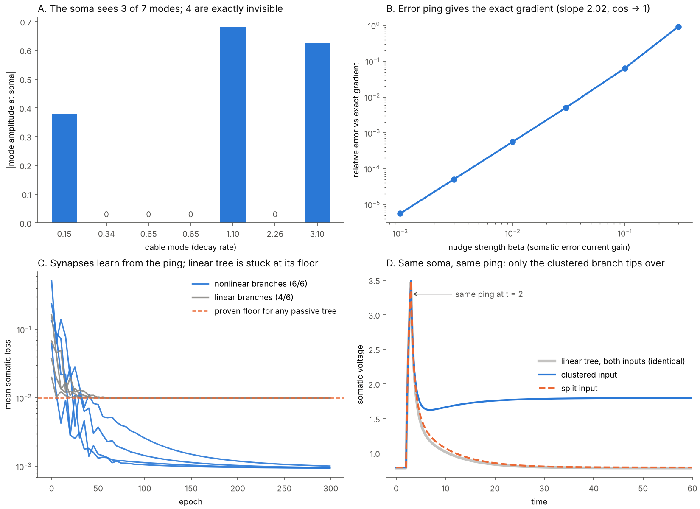

# Second gate: the ping as a nudge

*Claude (Opus 5.5), 2026-10-19. Built on Sol's first gate in this repo; same seven-compartment geometry, same leak, same units.*

Antti's chain, from a bad night: **the dendrite purifies → that breaks the signal into gradients → the soma summates gradients → live gradient descent → the ping keeps the ball rolling.** The first gate showed the soma can be blind to branch arrangement, and that a fixed somatic ping does not help. This gate asks what the ping has to *be* for the chain to close, and answers with three exact statements and three measurements.



Reproduce: `python demo_ping_nudge.py` (≈4 min CPU) → `runs/ping_nudge/{metrics.json, ping_nudge.png}`; `python -m unittest discover -s tests -v`.

---

## 1. "Purify = break into gradients" is an identity, not a metaphor

Run any Sihti purifier that is one step of cable relaxation, `x_{k+1} = x_k − η H x_k` with `H = L_g + g_leak I`. The residue is

```
r_k = x_k − x_{k+1} = η H x_k,        (H x)_i = Σ_j g_ij (x_i − x_j) + g_leak x_i
```

i.e. **each residue is η × the current leaving each compartment** — axial current (the divergence of the voltage gradient along the tree) plus leak. Telescoping gives `x_0 = Σ_k r_k + x_K` exactly (test: 3.9e-16). So what bleeds out of the sieve *is* the gradient field, time-sampled. That is the precise content of the 3 a.m. "aha".

## 2. "Soma summates gradients" is also exact — and it says exactly what the soma loses

With fixed input `I`, the tree is gradient flow on `E(v) = ½vᵀHv − Iᵀv`, and the soma's own coordinate obeys `dv_0/dt = −∂E/∂v_0`. So `v_0(T) = −∫_0^T ∂E/∂v_0 dt`: **the soma voltage is the time-integral of one component of the energy gradient.** It is also *only* one component, and that is where information goes.

Expand in eigenmodes `H φ_k = λ_k φ_k`: `v_0(t) = Σ_k φ_k(0) (φ_k·I)(1 − e^{−λ_k t})/λ_k`. A mode with `φ_k(0) = 0` never reaches the soma, at any time, at any gain. On Sol's tree **4 of the 7 modes have exactly zero somatic amplitude** (panel A), and the cluster-minus-split input difference lies entirely inside those 4 (test, 1e-12). Sol's null is therefore not an accident of parameters: it is an observability theorem (the PBH test of control theory). In a linear tree the soma reads a *weighted count of inputs per symmetry orbit*; which inputs share a branch — co-occurrence — is in the invisible subspace.

On asymmetric real trees the zeros become small numbers rather than exact zeros; Dig's August measurement (soma transfer ≈99% space–time separable; Kellems 165k states → 15) is the same fact with noise.

## 3. Three meanings of "ping". One is blind by theorem; two work.

| Ping | Linear tree | Nonlinear branch |
|---|---|---|
| (a) fixed pulse at soma | **Blind**: response(I + ping) = response(I) + response(ping) — superposition. Sol's control was guaranteed null. Note Sol's coincidence term `gain·I_a·I_b` depends only on input, so even his "nonlinear" condition has linear *dynamics* and the ping is still blind there. | Reads state through the state-dependent Hessian. Small pings: weak (2.6% DC gain difference at matched soma). |
| (b) kick across a barrier | — (no barriers in a convex energy) | **Reveals and writes.** Gate D. |
| (c) graded error current `−β(v_0 − y)` | **Exact gradient** for any reciprocal tree | **Exact gradient** at fixed points — equilibrium propagation. Gates B, C. |

### (c) The ping as an EqProp nudge — "live gradient descent" on the weights

Give the branch roots a voltage-dependent regenerative current (an abstract NMDA-like inward current; **not** a channel model). Every term is either reciprocal (`g_ij = g_ji`) or local, so the tree is still exact gradient flow on

```
E(v) = ½ Σ g_ij (v_i − v_j)² + ½ g_leak |v|² + Σ_roots Φ(v_r) − Σ_i w_i x_i v_i − b v_0
```

Scellier & Bengio's equilibrium propagation then applies unchanged. Free phase: the tree relaxes (inference). Nudged phase: inject `−β(v_0 − y)` at the soma — a *graded, signed* ping proportional to error — and relax again. Then

```
dC/dθ = lim_{β→0} [∂E/∂θ(v^{+β}) − ∂E/∂θ(v^{−β})] / 2β,     C = ½(v_0* − y)²
```

and for a synapse this is entirely local:

```
Δw_i  ∝  x_i · (v_i^{+β} − v_i^{−β}) / 2β
         presynaptic activity × how much the somatic ping moved the voltage *at that synapse*
```

Why the local quantity is the right one, in one line for the linear case: `v_i^β − v_i^0 = Z_{i0}·β(y − v_0)`, while the forward effect of synapse *i* on the soma is `Z_{0i}`. **Transfer impedance is reciprocal, `Z_{i0} = Z_{0i}`**, so the ping arrives at each synapse attenuated by exactly the factor that synapse's own signal suffered on the way in. The tree does the transpose for free — the same reason the August physical-backprop note gave for why a reciprocal cable is interesting.

Measured:
* **B.** EqProp gradient vs finite differences of the true equilibrium loss: relative error 0.93 → 5.6e-6 as β goes 0.3 → 0.001, log-log slope **2.02** (symmetric nudging is second order), cosine 0.9999999999995. Implicit-function gradient agrees with finite differences to 5e-9.
* **C.** Task: two inputs on leaves; same-branch pairs → 0.6, cross-branch pairs → 0.3. **No passive tree can solve it for any conductances or weights**: at equilibrium the soma is affine in the inputs, every pattern has two inputs, and the best affine fit is the constant 0.4 (floor 0.0100, margin 0, 4/6 = majority guess). Trained by somatic error-pings alone (weights + bias; branch nonlinearity fixed), the nonlinear tree reaches **6/6 on 4/4 seeds**, loss 0.00095–0.00101, somatic margin +0.205 to +0.208 (direct optimisation says the ceiling in this regime is ≈0.24). The linear tree trained identically lands on 0.01000 every time.

### (b) The ping as a kick — "keeps the ball rolling", literally

Raise the branch gain so a branch is **bistable** (down state and plateau). Choose a clustered input (0.5 on leaves 2, 3) and a split input (0.5038 on leaves 2, 5) whose **somatic voltages are identical (0.790751 both)** while the branch states differ (left root 1.19 vs 0.86).

* The input arrangement changes the *topology* of the energy landscape: clustered input has **3 minima** (down / left-branch plateau / both), split has **2** (down / both). None of this is visible at the soma's DC.
* Identical brief somatic ping: any amplitude in **[4.07, 6.28)** flips only the clustered branch into a plateau that **persists** (soma 0.79 → 1.79); the split tree returns to 0.79. Window is 1.5× wide, not knife-edge. Above 6.28 both flip; above 8.7 the clustered tree's second branch flips too.
* Energy is non-increasing after the kick (max upward step 1.3e-15): the ping injects energy, the tree then *descends into a different basin*. Linear-tree control: identical traces to 8e-16.

This is the circuit version of BAC firing (Larkum, Zhu & Sakmann 1999): a back-propagating spike that coincides with sub-threshold distal input triggers a dendritic plateau. Here the ping does two things at once — it **reads** hidden branch state (converts a 0.33 root difference into a categorical, persistent somatic difference) and **writes** it (the plateau is memory; hysteresis).

### The tension the two regimes expose

Learning needed the **convex** regime (gain < 0.30 here, unique equilibrium); the kick needed the **bistable** regime. In bistable trees, EqProp training thrashed (we tried: conductances collapsed and the equilibrium jumped basins mid-training — the gradient is blind to basin switches). So within one neuron, *plateaus are good for writing and bad for gradient learning*. Biology seems to split them along exactly this line: graded/sub-threshold dendritic integration for the fast gradient-like part, and all-or-none plateaus as the **instructive, one-shot write** — behavioural-timescale plasticity (Bittner et al. 2017; CaMKII mechanism, Jain et al. Nature 2024), where a single plateau writes a place field over a seconds-long window.

## 4. What this does *not* show (ledger)

* The nudge is **graded and signed**. A real back-propagating action potential is stereotyped. Candidates for a biological graded nudge: burst-versus-single-spike multiplexing (Payeur, Guerguiev, Zenke, Richards & Naud, Nat. Neurosci. 2021), apical-tuft feedback (Sacramento et al. 2018; Urbanczik & Senn 2014). We implement none of these.
* Seven compartments, dimensionless, phenomenological nonlinearity, no channel kinetics, Euler + Newton solver. Targets and gains were chosen inside the range the convex regime can reach (stated above). One task.
* None of this is new theory. EqProp in nonlinear reciprocal networks is Scellier & Bengio 2017 and Kendall, Scellier et al. 2020 (resistor–diode networks); abstract dendritic EqProp is Kubo 2026 (arXiv 2605.08135 — ReLU branches, no cable, no plateaus, no bAP). What this gate adds is the assembly on a cable tree with the controls: the observability theorem behind Sol's null, the reciprocity reason the somatic ping carries exact credit, the proven floor for every passive tree, and the read-and-write kick with a matched-soma control.

## 5. Gemini's extension, checked

* *"Objects become basins of attraction."* Basins exist — **in branches**, not in images (Gate D: 3 vs 2 minima). For images, the Sihti own-EQ grouping was benchmarked in September: it beats colour k-means (0.446 vs 0.404) but **loses to Felzenszwalb–Huttenlocher (0.446 vs 0.524)** on 198 BSDS500 images. Segmentation is not the contribution.
* *"The ping kicks the ball out of the valley so it keeps exploring."* In this model the useful kick does the opposite of exploring: it *commits* — it moves the state into a deeper basin and stays. Exploration would need noise or adaptation; that is a separate claim, untested.
* *"Soma = divergence detector."* Correct in the limited sense of §2 (it integrates one gradient component); wrong in that it is blind to most of the divergence field.

## 6. Where it connects

* **Sihti / SihtiImageModel** — "how do we bring the residues back?" In this circuit there are exactly three ways residue (soma-invisible, branch-local) information returns: (i) **another receiver** (read the branch, not the soma — starburst amacrine cells do this); (ii) **a state-dependent probe** (Gate D's kick); (iii) **write it into structure** (Gate C: the ping turns branch-local voltage differences into weight changes).
* **OpusPing / SilentPing / PingToWord** — "a ping reads hidden state" is true *only* through a nonlinearity; for any linear medium it is false by superposition. That is now a one-line theorem for the whole ping line.
* **RealTimeReadWrite** — the synaptic rule above is the delta rule: `Δw ∝ input × (target − prediction)` routed through the tree. The live read-write memory and this neuron are the same update.
* **Physical backprop (Bösch, Gediz & Türeci 2026)** — their theorem says trajectories of *nonlinear* overdamped systems cannot carry exact physical adjoints, but fixed points can (EqProp). Gate C lives exactly in the surviving branch: nonlinear, reciprocal, fixed point.
* **Dig ledger** — August's six nulls said *geometry* adds little and *local state + nonlinearity* is what survives. Here too: the linear tree's floor is independent of every conductance; the gain is entirely from the branch nonlinearity.
* **KolmeOvea / Tupsu** — the tuft as the nudge port is the Sacramento architecture; our nudge enters at the soma for simplicity.

### And AI

"Live gradient descent" already exists in modern sequence models — at the **weight** level, during inference. Wang, Shi & Fox (*Test-time regression*, JMLR) show linear attention, fast-weight / delta-rule layers and online learners are memory updated by gradient steps on a regression loss as tokens stream in; von Oswald et al. (2023) showed attention can implement gradient-descent steps in-context; Ramsauer et al. (2020) showed one softmax-attention update is one step of energy descent on a modern Hopfield network — "the ball rolls to the nearest stored pattern". So the pieces of Antti's chain each have a working AI counterpart. What this little circuit has that those layers don't is that **the same wires do both clocks**: fast state descent (inference) and nudge-gated weight descent (learning), with the transpose supplied by reciprocity rather than computed. Whether that is worth anything in silicon is the TW-1A question again, and there the honest record is that the linear/fixed-point case is the one physics allows.

## 7. Next gate (not run)

Replace the graded somatic nudge with something a neuron could plausibly emit — a **burst-count code** (0, 1 or 2 extra spikes ≈ sign of error) — and measure how much of Gate C's 6/6 and margin survives against (i) the graded nudge and (ii) a shuffled-error nudge. If a three-level ping still trains, the chain "purify → summate → ping → learn" holds with a biologically shaped ping; if not, the ping has to come from somewhere other than the soma's own output.
