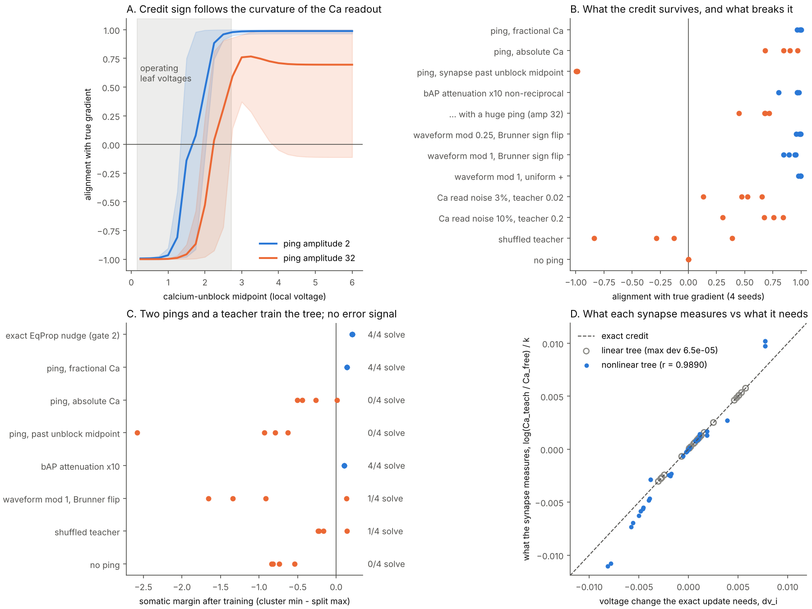

# Gate 3: the ping with state, up and down

*Claude (Opus 5.5), 2026-10-19, after Sol's review of gate 2. This gate fuses the two branches; Sol's corrections are folded in, not argued with.*



Reproduce: `python demo_ping_state.py` (≈12 min CPU) → `runs/ping_state/` (`--replot` redraws from saved metrics); tests: `python -m unittest tests.test_ping_state -v`.

## 0. Where the two branches stood

| Point | Who | Status after this gate |
|---|---|---|
| A linear ping cannot reveal input-driven state under a **fixed** operator | Claude (gate 2) | Holds — superposition |
| …but a linear probe **can** read the operator itself, y = H(W)p, so memory in conductances/synapses is linearly readable | Sol | **Correct; gate 2's "only through nonlinearity" was too broad** and is narrowed in its doc |
| State is not error | Sol | **Correct, and it turns out not to matter**: below, no signal anywhere encodes the error |
| A real bAP is not stereotyped (Brunner & Szabadics 2016; Martin-Burgos et al. 2026) | Sol | **Correct.** Measured here what that analog channel contributes |
| Two different writes: activity state (plateau) vs the response rule (synapse) | Sol | **Correct.** Gate 2's kick wrote the first; this gate writes the second |

The fusion of the first two rows is the frame for everything below. In a nonlinear dendrite the operator a ping travels through is **H(W, v)**: slow memory W (synaptic weights, conductances) *and* fast state v (local depolarisation, plateaus) both live in it. One probe reads both. A linear cable is just the special case where v drops out.

## 1. The loop

```
UP      inputs x  ->  branch voltages v  ->  soma v0         gradient flow on E(v; W)
TEACH   weak top-down current at the soma  beta (y - v0)     (the target lives here; apical/context drive)
DOWN    a ping leaves the soma, spreads back through the cable, linearised at the current state:
            delta(t) = int exp(-H(W,v)(t-s)) e0 A(s) ds      (analog waveform modulation optional)
READ    each active synapse turns ping + its local voltage into calcium through an
        NMDA-like unblock g:   Ca_i = x_i int [ g(v_i + gamma_i delta_i(t)) - g(v_i) ] dt
WRITE   the synapse compares two pings: one before the teacher (kept as its trace), one during:
            dw_i = [x_i > 0] * log( Ca_i^teach / Ca_i^free ) / (k beta)
```

Nothing in this loop is an error signal. The soma emits no error, and the ping carries none. The error exists only as **the difference between two local states, sampled by two pings**.

## 2. The identity that makes it work

Take the sub-threshold unblock as exponential, g(u) = e^{k(u−θ)} (Mg²⁺ unblock is approximately this below its midpoint). Then

```
Ca_i(v) = x_i e^{k(v_i − θ)} · ∫ ( e^{k γ_i δ_i(t)} − 1 ) dt

log( Ca_i^teach / Ca_i^free ) = k (v_i^teach − v_i^free)  +  log[ ∫(e^{kγδ^teach} − 1) / ∫(e^{kγδ^free} − 1) ]
```

If the ping's local shape does not depend on state (linear cable, no waveform modulation), the second term is **exactly zero for any ping amplitude and any attenuation γ_i**, and

```
dw_i = (v_i^teach − v_i^free)/β   =  the equilibrium-propagation update.
```

Four consequences, each measured:

1. **The credit travels in the slow, reciprocal cable, not in the ping.** The teacher's shift reaches each synapse passively, attenuated by Z_i0 = Z_0i, exactly the factor that synapse's signal suffered on the way up. The ping only *samples* it. So the active, non-reciprocal bAP (boosted by Na⁺ channels, attenuated by A-type K⁺) does not need to be reciprocal: γ_i cancels in the ratio.
2. **The comparison must be fractional.** The absolute rule `Ca^teach − Ca^free ≈ x_i ∫[g′(v_i+δ) − g′(v_i)]dt · Δv_i` is EqProp times a positive per-synapse factor (test: no negative ratio). But that factor grows like e^{k v_i} and spans ~1000×, so the summed update follows the most-depolarised patterns, not the loss.
3. **Sign law.** That same factor is positive only while v_i + ping stays on the convex side of the unblock curve. Past the midpoint, the credit *inverts* and the tree learns the opposite task.
4. **Waveform modulation is a second, separate channel.** With local ping gain (1 + mod_i(v0 − v_ref)), the second term becomes ≈ mod_i Δv0: a **global error broadcast**, the same for every synapse, signed by mod_i, with no per-synapse credit. Brunner & Szabadics found mod changes sign along the dendrite, so where it is large it is wrong at half the synapses.

## 3. Measurements

*(from `docs/ping_state_metrics.json`)*

Alignment = cosine between the six patterns' local updates (concatenated) and the true gradient, at **probe states** (each seed after 30 epochs of exact EqProp, where the errors have mixed signs). At the initial state every output overshoots every target, so even shuffled labels align; that measurement would be meaningless and is not used.

**A. Sign law** (panel A). With the unblock midpoint above the operating leaf voltages, alignment is ≈ +0.99 for ping amplitude 2. Moving the midpoint down into and below the operating range flips it to ≈ −1.0. A huge ping (amplitude 32) carries the local voltage past the midpoint by itself and lowers alignment to ≈ 0.7 even in the "safe" range.

**B. What the credit survives** (alignment, 4 seeds):

| Condition | Alignment |
|---|---|
| ping, fractional Ca | 0.965 – 1.000 |
| ping, absolute Ca | 0.681 – 0.968 |
| synapse past the unblock midpoint | −0.999 – −0.986 |
| bAP attenuation ×10, non-reciprocal | 0.80 – 0.98 |
| … with a huge ping (amp 32) | 0.45 – 0.72 |
| waveform modulation 0.25 with Brunner sign flip (≈ measured depth) | 0.956 – 0.996 |
| waveform modulation 1 with Brunner sign flip | 0.845 – 0.953 |
| waveform modulation 1, uniform sign | 0.976 – 0.999 |
| Ca read noise 3 %, weak teacher (β = 0.02) | 0.13 – 0.65 |
| Ca read noise 10 %, strong teacher (β = 0.2) | 0.31 – 0.84 |
| shuffled teacher | −0.84 – +0.39 |
| no ping | 0 exactly |

**C. Training** (300 epochs, Adam on the local updates, 4 seeds; "solve" = 6/6 patterns):

| Condition | Solve | Somatic margin |
|---|---|---|
| exact EqProp nudge (gate 2 reference) | 4/4 | +0.204 – +0.208 |
| **two pings, fractional Ca** | **4/4** | **+0.142** |
| two pings, absolute Ca | 0/4 | −0.504 – +0.011 |
| synapse past the unblock midpoint | 0/4 | −2.579 – −0.629 (wrong patterns win) |
| bAP attenuation ×10 | 4/4 | +0.102 |
| waveform modulation 1, Brunner flip | 1/4 | −1.653 – +0.133 |
| shuffled teacher | 1/4 | −0.234 – +0.142 |
| no ping (weights frozen; only the somatic bias learns) | 0/4 | −0.839 – −0.540 |

**D. What each synapse measures vs what it needs** (panel D, β = 0.02, 48 synapse samples). Linear tree: the measured log-ratio equals the needed Δv_i to a maximum relative deviation of 6.5 × 10⁻⁵. Nonlinear tree: r = 0.989, maximum relative deviation 0.37 — the residual is the second term of §2, the ping's own shape changing with branch state.

**Two corrections to numbers stated earlier in conversation.** (1) Read-noise tolerance measured at the *initial* state looked generous (alignment ≥ 0.9 at 1–3 % noise). At probe states it is much worse (table above). Calcium read noise, not waveform shape, is the practical weak point of the two-ping comparison. (2) Alignment does not predict training by itself: deep sign-flipped modulation keeps alignment 0.85–0.95 yet solves 1/4, because its wrong-signed part is systematic and accumulates.

## 4. What "the ping up and down" now means

* **Up** writes *fast state*: each synapse's input leaves a local voltage (and, in bistable branches, possibly a plateau — gate 2's kick).
* **Context arrives at the soma** (the teacher). Its effect flows back down the passive cable, reciprocally, and sets each synapse's new local voltage. That flow *is* the credit.
* **The ping goes down** and turns local state into a calcium event at every active synapse. Each synapse remembers the calcium of the previous ping (its trace — the "local trace" Sol's return meets) and compares.
* **The write** is the fractional change. Read and write are the same event: the ping that reads the current operator H(W, v) at the synapse is also what triggers the change to W.

That is real-time read/write in one cell, and it is the delta rule of RealTimeReadWrite, `dw ∝ x·(target − prediction)`, with the "(target − prediction)" never computed anywhere — it appears as Δv_i.

## 5. Predictions a real neuron could fail

* **P1 — sign flips with local depolarisation.** Credit should weaken and then invert at synapses whose local voltage plus bAP crosses the steep part of the NMDA unblock. A branch already depolarised by its own input should learn in the opposite direction to the same teacher.
* **P2 — fractional, not absolute.** Synapses that normalise to their own recent calcium (a sliding reference, BCM-like) should follow the teacher; ones that do not should be dominated by their most depolarised episodes.
* **P3 — bAP attenuation is irrelevant to credit sign** under fractional comparison; it matters only for pings large enough to leave the exponential part of the unblock curve.
* **P4 — realistic waveform modulation (~8%) neither creates nor destroys credit** in this circuit. If waveform state matters for learning in vivo, it must be through a different route (e.g. the proximal repolarisation / R-type Ca²⁺ mechanism Brunner & Szabadics identified acting as a gain, or as Sol suggested, modulating *when* writes occur).

## 6. Ledger

* The free and teacher pings are separated in time by construction, and the synapse is assumed to hold the free calcium as a trace. How long that trace must last, and what happens when pings are self-generated at state-dependent rates, is not tested (next gate).
* The teacher is a somatic current; the biological version is apical/contextual drive, not implemented.
* The unblock curve is a sigmoid with midpoint above the operating voltages ("convex regime"); the exactness argument uses its exponential approximation.
* Seven compartments, dimensionless, one task, four seeds, Adam on the local updates (Adam normalises per-parameter scale, which partly hides magnitude distortion — the absolute-rule failure survives it anyway).
* **Prior art, closest first.** Guerguiev, Lillicrap & Richards (eLife 2017): segregated apical dendrites deliver the target; each hidden unit yields one apical plateau in a forward phase and one in a target phase, and learning is driven by their difference — the two-window structure of this gate, at the level of plateaus rather than synaptic calcium. Clopath, Büsing, Vasilaki & Gerstner (Nat. Neurosci. 2010): voltage-based plasticity where potentiation needs presynaptic activity and *local* postsynaptic voltage above a threshold — the same ingredients, without the two-ping comparison. Urbanczik & Senn (Neuron 2014): the error is formed locally as the difference between the somatic spike and the dendrite's prediction. Scellier & Bengio (2017): the two-phase comparison. Graupner & Brunel (PNAS 2012) and Shouval, Bear & Cooper (PNAS 2002): calcium-level plasticity rules. Brunner & Szabadics (Nat. Commun. 2016) and Martin-Burgos et al. (bioRxiv 2026): the state-dependent waveform. What is specific here: the exact log-ratio identity, the cancellation of bAP non-reciprocity, the convex-regime sign law with its inverted-task failure, and the size of the waveform channel at measured depth.


## 7. After the divergence (2026-10-19, written after reading Gemini's critique and the "time windows as lenses" picture)

**The teacher is the later window.** The objection to gates 2–3 was that a somatic teacher current is an external supervisor. The cortical picture puts the context at the apical tuft instead: "earlier window: constrained local interpretation → later window: richer contextual state". That is exactly this gate's two pings. The first samples each synapse before context arrives, the second while it is present, and

```
dw_i ∝ x_i · [ v_i(later window) − v_i(earlier window) ]
```

So moving the teacher to the tuft does not remove it; it says where it lives. Guerguiev et al. 2017 built this arrangement with apical plateaus.

**The limit on "no teacher".** If the later window carries nothing the basal input did not already have — if it is only the cell's own echo — then "make the early state match the late state" is satisfied by any weights: the self-supervised collapse problem. A loop with no outside information can carve basins and hold state (gate 2's plateau kick), but it cannot learn a task. "Contextual" has to mean information from outside the cell's own input: other columns, another modality, later evidence.

**Geometry decides what the ping must carry.** In this gate the context enters at the soma, so every synapse receives it passively through the cable and the ping only samples it; waveform modulation at measured depth contributed nothing. In a real L5 cell the tuft is far from the basal synapses and passive tuft-to-basal transfer is weak. There the context can only reach basal synapses through the somatic event — a burst versus a single spike (Payeur et al. 2021), or a state-shaped waveform (Brunner & Szabadics 2016; Martin-Burgos et al. 2026). With context at the tuft, the shaped ping may be the only channel rather than a negligible one.

**Two claims from the critique, checked.**
* *"L2/3 dendritic XOR is the residue extractor (fires when A ≠ B)."* Gidon et al. 2020's dendritic calcium spikes are largest near threshold and weaker for stronger input. XOR follows because A alone or B alone is near threshold and A + B overshoots. That is a band-pass on input *amount*, not a detector of A ≠ B, so it is not a spatial-gradient (residue) extractor.
* *"A blind somatic ping's echo separates the patterns without a teacher."* That is gate 2's small-ping curvature probe, measured there at about a 2.6 % difference at matched somatic voltage. Real, but weak; the strong unsupervised read was the barrier kick.

## 8. Next gate

1. **Context at the tuft.** A two-zone tree (basal branches, soma, long trunk, tuft); the teacher enters at the tuft. Measure how much credit reaches basal synapses passively versus through a burst-coded or waveform-coded somatic ping, against shuffled-context and no-context controls.
2. **Real time.** The soma emits its own pings when it crosses threshold, the context arrives with a delay, and each synapse's calcium trace decays with τ. Measure the window of τ and delay over which the update still aligns, and whether state-dependent ping *rate* contaminates the fractional comparison.
