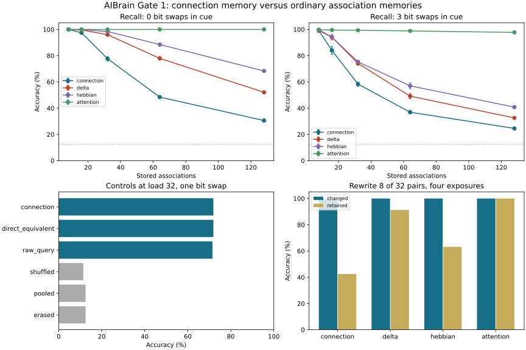

# AIBrain — an experience changes the next answer

**Observe a pattern → write local connections → ask with a partial cue → read the response.**

This is the AI version of the small core behind the SihtiBrain experiments:
**keep more information than the first summary exposes, then use a query to
make the relevant information readable.** Experiences change the connections
that future queries pass through. Clearing temporary activity does not erase
those connections.

The first implementation is a CPU-only associative-memory block, not a complete
brain or a language model. It learns new arbitrary pattern–value bindings online,
without backpropagation or pretrained weights. The value is supplied alongside
the pattern at write time: **paired association storage, not label-free semantic
discovery.**

## Try it

Clone or download this branch. Open **[`demo/index.html`](demo/index.html)** in a
browser. No server or installation is needed for the interactive demo.

1. Pick an example cue, swap a bit, and **Ping / query**.
2. Select a different value and **Write association**; query again.
3. **Clear activity**, then query: the association remains.
4. **Erase connections**, then query: the association is gone.

The cards are input examples; the memory block retrieves from its 512 connection
values, not from those cards. Demo state lasts only until the page is reloaded.
It does not learn visual concepts from these random pixel patterns.

To run the Python experiment:

```bash
python -m pip install -r requirements.txt
python -m unittest discover -s tests -v
python -m aibrain.benchmark --output runs/gate1
```

Python 3.10+, NumPy and Matplotlib; no GPU or external dataset. A smaller smoke run:

```bash
python -m aibrain.benchmark --episodes 2 --seeds 41 --loads 8 32 --output runs/smoke
```

Optional JavaScript numerical-parity check (Node 18+ and Python on PATH):

```bash
node tests/test_demo.mjs
```

## What happened

Five fixed seeds × 20 independent episodes per seed. Each association is seen
once. Keys are fresh 64-dimensional patterns with eight active bits; there are
eight balanced values. The corrupted cue swaps one active and one inactive bit,
so all cues still have exactly the same scalar pooled mean.

| Stored pairs | Connection memory | Equal-size Hebbian fast weights | Equal-size delta fast weights | Full-history attention |
|---:|---:|---:|---:|---:|
| 8 | 100.0% | 100.0% | 100.0% | 100.0% |
| 16 | 95.9% | 99.8% | 99.3% | 100.0% |
| 32 | 71.9% | 95.4% | 92.0% | 100.0% |
| 64 | 45.2% | 80.3% | 70.3% | 100.0% |
| 128 | 29.0% | 59.5% | 46.0% | 100.0% |

All three matrix memories use **2,048 bytes** of persistent float32 arrays.
Attention stores all observed key/value pairs: 9,216 bytes at 32 pairs and
36,864 bytes at 128. Object overhead and temporary computation buffers are
excluded for every method. Chance is 12.5%.

**The mechanism works; this particular connection writer loses to ordinary
fast-weight memory as load grows.** After rewriting eight of 32 bindings four
times, it recalls the changed bindings at 99.4%, but retains only 42.5% of the
unchanged ones. Shared-feature interference is the limiting problem.



The exact normalized matrix read ties the graph read. Mean-centering the cue
helps very little here (71.9% versus 71.5% at load 32 with one swap). We have
**not** demonstrated that relaxation, a purification step, or a ping improves on
standard fast weights.

[Full protocol and interpretation](docs/GATE1.md) ·
[per-seed and per-episode receipts](docs/gate1_metrics.json) ·
[design fixed before the benchmark](docs/superpowers/specs/2026-10-19-queryable-memory-design.md)

## The small block in AI terms

- **Local state:** a key's detailed features, beyond its scalar mean.
- **Persistent memory:** bounded feature-to-value connection strengths.
- **Query / attention:** a centered partial cue clamped at the key nodes.
- **Inference:** value-node relaxation, or its exact direct matrix solution.
- **Learning:** each observed pair updates only rows selected by its key.

For a key `x` and observed value vector `v`, the local writer is

```math
W_{ij}\leftarrow (1-\eta x_i)W_{ij}+\eta x_i v_j,\qquad \eta=0.5.
```

The query is the normalized residue `q = (x − mean(x)) / ||x − mean(x)||`.
For a constant cue, we return zero rather than divide by zero. The response is

```math
h_j^*=\frac{\sum_i W_{ij}q_i}{1+\sum_i W_{ij}}.
```

This is also the equilibrium of a leaky positive-conductance graph with the key
nodes clamped to `q`. It is **exactly a normalized linear fast-weight read** in
this first version. The query carries a 64-dimensional cue and the echo has
eight components; neither is a literal scalar biological spike. Our common-mode
split is Sihti-inspired, not the original spatial edge-aware Sihti sieve.

```python
import numpy as np
from aibrain import ConnectionMemory

memory = ConnectionMemory(dim=64, values=8)
key = np.zeros(64)
key[:8] = 1
memory.write(key, np.eye(8)[3])  # observe a paired value
memory.clear_activity()
print(memory.read(key).argmax())  # 3: read only needs the cue
```

## How the diverging paths relate

| Repository | Concrete question | What AIBrain keeps |
|---|---|---|
| [SihtiBrain](https://github.com/anttiluode/SihtiBrain/tree/claude/ping-as-nudge) | What can branch-local state or a teaching nudge reveal? | Summary and local detail are different readouts. |
| [SihtiBrainV2](https://github.com/anttiluode/SihtiBrainV2/tree/codex/gate5-credit-stopping-test) | Can a later event read/write connections? | Test persistent memory after activity reset; compare simpler learning rules. |
| [SihtiBrainV3](https://github.com/anttiluode/SihtiBrainV3/tree/codex/v3-alternating-probe) | Can changing probes reveal hidden distinctions? | Preserve the query direction in the readout. |
| **AIBrain** | Does this make a useful AI memory block? | Measure recall, capacity, overwrite interference and conventional controls. |

V2's latest two-ping stopping test did not beat a simpler event rule. V3's
phase-averaged tracker tied symmetric routing and lost to a velocity baseline.
Those outcomes narrow the question; they are not evidence of a general AI
advantage. This repo does not modify any of the three references.

The next worthwhile experiment is **selective writing with less interference**,
under the same byte budget and fresh seeds—not a larger neuroscience analogy.
